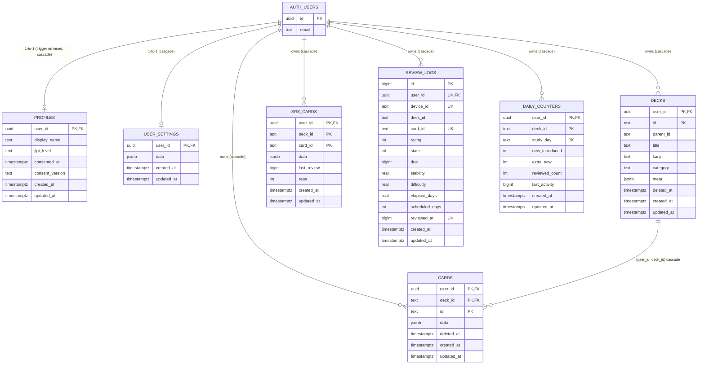

# Entity Relationship Diagram (ERD) — GoRaku Fase B1

Diagram di bawah memodelkan seluruh tabel PostgreSQL pada schema `public` (dengan `ENABLE` + `FORCE ROW LEVEL SECURITY`) beserta relasinya terhadap `auth.users` milik Supabase Auth. Tabel `decks`, `cards`, `srs_cards`, `review_logs`, dan `daily_counters` disiapkan sekarang agar skema ditinjau satu kali sebelum sinkronisasi studi diaktifkan pada **Fase B2**.

