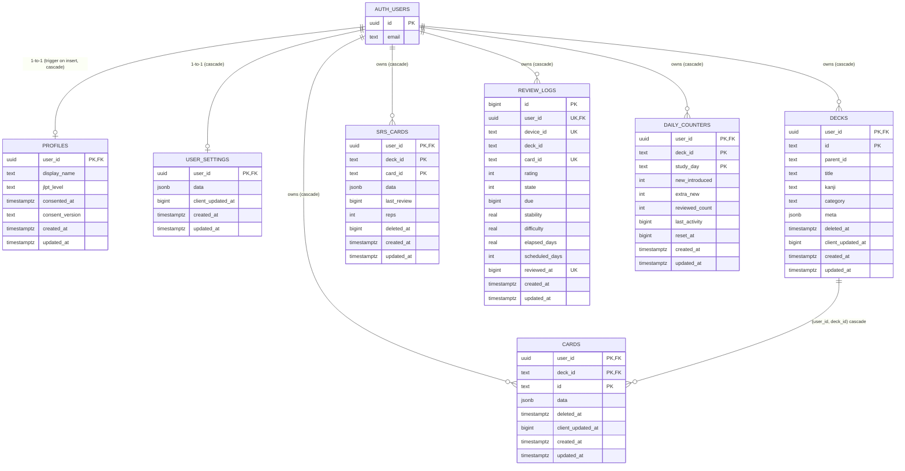

# Entity Relationship Diagram (ERD) — GoRaku Fase B1 & B2

Diagram di bawah memodelkan seluruh tabel PostgreSQL pada schema `public` (dengan `ENABLE` + `FORCE ROW LEVEL SECURITY`) beserta kolom sinkronisasi Fase B2 (`client_updated_at`, `srs_cards.deleted_at`, `daily_counters.reset_at`) dan relasinya terhadap `auth.users` milik Supabase Auth.

## Ringkasan RPC Merge Atomik (Fase B2)

Seluruh fungsi pada migrasi `202611270001_sync_b2.sql` berjalan dengan `SECURITY INVOKER`, `SET search_path = public`, hak eksekusi hanya untuk `authenticated` (dicabut dari `public` dan `anon`), selalu memaksa `user_id = (select auth.uid())`, serta mengembalikan `{ applied, skipped, rejected[] }` agar satu baris tidak valid (CHECK/FK) tidak menggagalkan seluruh batch:

| RPC | Aturan Merge Per Baris | Indeks Keyset Pull |
| :--- | :--- | :--- |
| `sync_upsert_settings(jsonb)` | LWW ketat pada `client_updated_at` (`>` menang; seri pertahankan server) | `(user_id, updated_at desc)` |
| `sync_upsert_decks(jsonb)` | LWW ketat pada `client_updated_at`, termasuk tombstone `deleted_at` | `(user_id, updated_at asc, id asc)` |
| `sync_upsert_cards(jsonb)` | LWW ketat pada `client_updated_at`; pelanggaran FK deck hanya menolak baris terkait | `(user_id, updated_at asc, deck_id asc, id asc)` |
| `sync_upsert_srs(jsonb)` | `last_review` lebih besar menang, seri → `reps` lebih besar; hidup hanya bila `deleted_at IS NULL` atau `last_review > deleted_at` | `(user_id, updated_at asc, deck_id asc, card_id asc)` |
| `sync_upsert_counters(jsonb)` | `reset_at` lebih besar mereset counter ke epoch baru; `reset_at` sama → `GREATEST(...)` | `(user_id, updated_at asc, deck_id asc, study_day asc)` |
| `sync_insert_review_logs(jsonb)` | Append-only `ON CONFLICT (user_id, device_id, card_id, reviewed_at) DO NOTHING` | `(user_id, id asc)` |
