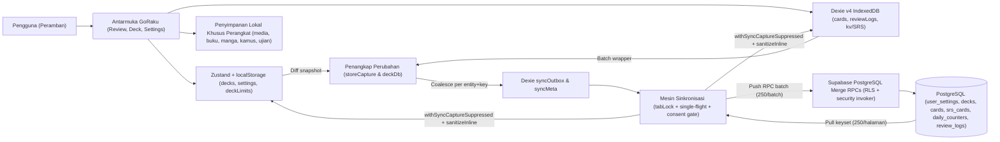
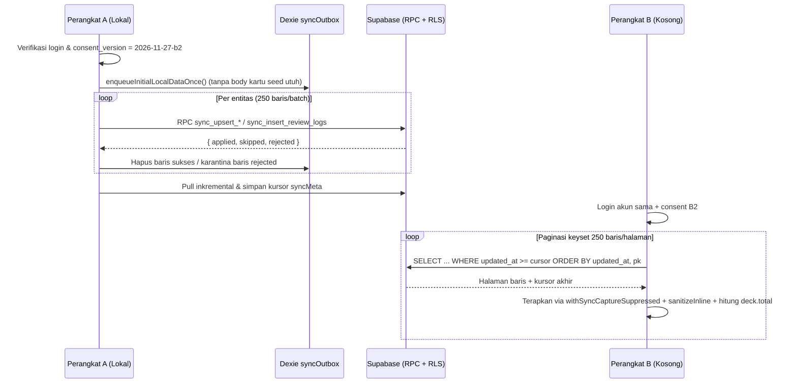
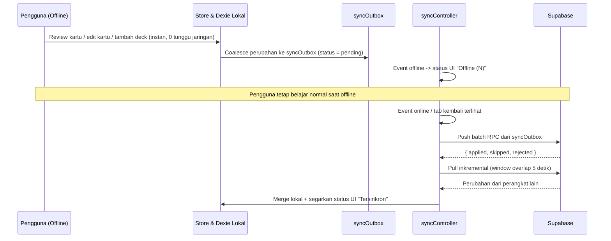
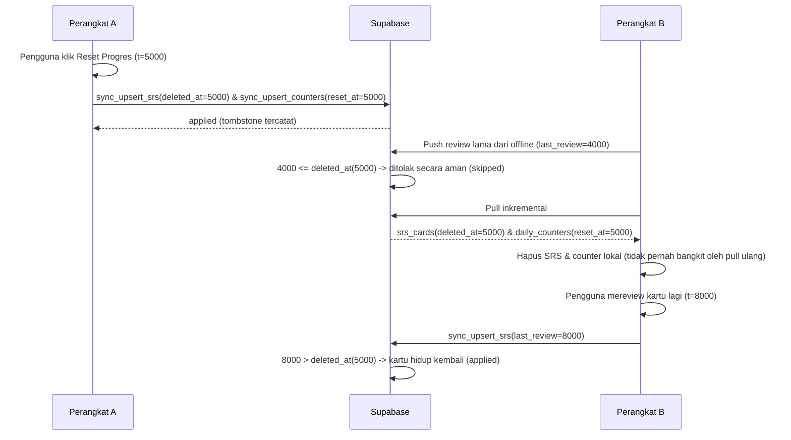

# Arsitektur & Operasional Sinkronisasi Multi-Perangkat GoRaku (Tahap B2)

Dokumen ini menjelaskan rancangan teknis, aturan penggabungan (*merge rules*), aliran data, hasil pengukuran, batas paket gratis Supabase, panduan operasional, serta keputusan terbuka dari mesin sinkronisasi **local-first** GoRaku Tahap B2.

---

## 1. Gambaran Arsitektur (*Local-First*)

GoRaku mempertahankan prinsip **local-first**: seluruh aktivitas belajar (menilai kartu FSRS, Undo, menambah/menyunting kartu, membaca novel/manga, kamus Yomitan) tetap membaca dan menulis langsung ke penyimpanan peramban (`localStorage` + `IndexedDB/Dexie`) tanpa pernah menunggu jaringan. Server Supabase berfungsi sebagai salinan tersinkronisasi per akun di belakang *Row Level Security* (RLS).

### Komponen Utama

1. **ID Stabil (`src/lib/stableId.ts`):**
   - Deck dan kartu baru memakai UUID kriptografis (`crypto.randomUUID()` dengan fallback `crypto.getRandomValues`, tanpa `Math.random()`).
   - Impor CSV/JSON memakai hash konten deterministik sinkron (`dual-cyrb53 + tail panjang`) atas `word + reading + meaning` yang dinormalisasi NFC & trim, dengan akhiran `-2`, `-3` untuk baris kembar di berkas yang sama.
2. **Skema Dexie v4 & Outbox Terkoalesensi (`src/lib/deckDb.ts`, `src/lib/sync/storeCapture.ts`):**
   - Tabel baru per pengguna `syncOutbox` (`++id, [entity+key], entity, status, clientTs`) dan `syncMeta` (`key`).
   - Mutasi pada `useAppStore` (hanya field identitas deck — field turunan `due`, `total`, `progress`, `updated` diabaikan) dan `useReviewStore` ditangkap via diff snapshot; mutasi kartu/log di `deckDb.ts` (termasuk dari Web Worker impor `.apkg`) ditangkap per batch.
   - Banyak perubahan pada `(entity, key)` yang sama menyatu (*coalesce*) menjadi satu baris di outbox.
   - `withSyncCaptureSuppressed()` mencegah gema (*echo loop*) ketika data hasil *pull* diterapkan ke penyimpanan lokal.
3. **Push Batch Atomik via RPC (`supabase/migrations/202611270001_sync_b2.sql`, `src/lib/sync/engine.ts`):**
   - Enam fungsi PostgreSQL `security invoker` dengan `set search_path = public` (hanya `authenticated`): `sync_upsert_settings`, `sync_upsert_decks`, `sync_upsert_cards`, `sync_upsert_srs`, `sync_upsert_counters`, `sync_insert_review_logs`.
   - Urutan kirim terjamin: `settings -> decks (induk sebelum sub-deck) -> cards -> srs_cards -> daily_counters -> review_logs` dalam batch 250 baris dengan `yieldToEventLoop()` antar batch agar UI tetap responsif.
   - Kegagalan per baris (mis. melebihi CHECK ukuran 64 KB atau FK hilang `23503`) dikembalikan dalam daftar `rejected` dan dipindahkan ke status `quarantined` tanpa menggagalkan baris valid lainnya.
4. **Pull Inkremental Berhalaman & Kunci Lintas Tab (`src/lib/sync/engine.ts`, `src/lib/sync/tabLock.ts`, `src/lib/sync/syncController.ts`):**
   - Paginasi *keyset* 250 baris/halaman terurut `(updated_at ASC, pk ASC)` dengan jendela tumpang-tindih (*overlap window*) 5 detik untuk melindungi terhadap perbedaan jam transaksi server; `review_logs` memakai kursor monotonic `id > last_id`.
   - Seluruh isi kartu hasil *pull* disanitasi ulang dengan `sanitizeInline()`.
   - Kunci lintas-tab menggunakan `navigator.locks` (*Web Locks API*) dengan fallback lease `localStorage` 20 detik.
   - Tanpa WebSocket/Realtime (CSP tetap utuh); pemicu berbasis event (login + consent valid, debounce outbox 2,5 detik, `online`, `visibilitychange`, dan polling rendah setiap 60 detik hanya saat tab terlihat dengan ambang *idle pull* 5 menit).
   - **Gerbang Persetujuan:** unggahan data studi diblokir total hingga `profiles.consent_version === CURRENT_CONSENT_VERSION` (`2026-11-27-b2`).

---

## 2. Tabel Aturan Penggabungan (*Merge Rules*)

Seluruh aturan diimplementasikan identik pada sisi server (SQL RPC) dan sisi klien (`src/lib/sync/merge.ts`), bersifat **idempoten** dan **independen terhadap urutan** (*order-independent*):

| Entitas / Tabel | Kunci Primer | Aturan Penggabungan | Pemecah Seri (*Tie-Breaker*) | Hapus / Reset |
|---|---|---|---|---|
| `user_settings` | `(user_id)` | Last-Writer-Wins (LWW) pada `client_updated_at` (ms) | Baris yang lebih dulu ada bertahan (`incoming > current`) | Tidak dihapus (selalu upsert; cascade saat hapus akun) |
| `decks` | `(user_id, id)` | LWW pada `client_updated_at` (ms); field turunan tidak dikirim | Baris yang lebih dulu ada bertahan | Soft-delete `deleted_at` (LWW); edit lebih lama tidak membangkitkan tombstone |
| `cards` | `(user_id, deck_id, id)` | LWW pada `client_updated_at` (ms); sanitasi HTML saat pull | Baris yang lebih dulu ada bertahan | Soft-delete `deleted_at` (LWW); pindah deck = tombstone kunci lama + upsert kunci baru |
| `srs_cards` | `(user_id, deck_id, card_id)` | `last_review` lebih besar menang | Jika `last_review` seri, `reps` lebih besar menang | `deleted_at` (epoch ms); baris hidup hanya jika `last_review > deleted_at` (review baru sesudah reset membangkitkan kembali) |
| `daily_counters` | `(user_id, deck_id, study_day)` | `GREATEST` per kolom (`new_introduced`, `extra_new`, `reviewed_count`, `last_activity`) dalam epoch `reset_at` yang sama | Nilai maksimum bertahan | `reset_at` (epoch ms) lebih besar mendominasi & mereset seluruh counter hari tsb |
| `review_logs` | `UNIQUE (user_id, device_id, card_id, reviewed_at)` | Append-only idempoten (`ON CONFLICT DO NOTHING`) | Duplikat diabaikan tanpa galat | Append-only di server (statistik lokal mengikuti tabel lokal; Undo sebelum push membatalkan antrean outbox) |

---

## 3. Diagram Alir Data (DFD Level 1)



---

## 4. Diagram Urutan (*Sequence Diagrams*)

### 4.1 Sinkronisasi Pertama (*First Sync*)



### 4.2 Sunting & Review Offline lalu Rekoneksi



### 4.3 Resolusi Konflik (Edit Kartu LWW & Review SRS Paralel)

```mermaid
sequenceDiagram
    participant A as Perangkat A
    participant S as Supabase Merge RPC
    participant B as Perangkat B

    Note over A,B: Keduanya offline menyunting kartu C1 & mereview kartu C2
    A->>S: sync_upsert_cards(C1, ts=1000) & sync_upsert_srs(C2, last_review=1000)
    S-->>A: applied (C1 ts=1000, C2 lr=1000)
    B->>S: sync_upsert_cards(C1, ts=2000) & sync_upsert_srs(C2, last_review=1500)
    S->>S: LWW 2000 > 1000 (menang); SRS 1500 > 1000 (menang)
    S-->>B: applied (C1 ts=2000, C2 lr=1500)
    A->>S: Pull inkremental
    S-->>A: C1 (ts=2000) & C2 (lr=1500)
    A->>A: Kedua perangkat konvergen ke state identik
```

### 4.4 Reset Progres & Bangkit Kembali (*Revive*)



---

## 5. Pengukuran Teramati & Batas Paket Gratis Supabase

### Hasil Pengukuran B2 (Simulasi `fake-indexeddb` + `MockSyncServer`)

Diukur langsung melalui `src/lib/sync/__tests__/firstSyncAndLargeDeck.test.ts` (batch push 250, halaman pull 250):

| Metrik | Nilai Terukur | Keterangan |
|---|---|---|
| Unggah awal 5.000 kartu (termasuk 1x simulasi reload di tengah jalan) | **25,1 detik** (`25.127 ms`) | Di `fake-indexeddb` pure-JS; termasuk 21 RPC push + 26 halaman pull awal |
| Jumlah permintaan RPC push untuk 5.000 kartu + 1 deck | **21 permintaan RPC** | Tepat `ceil(5000 / 250) + 1 = 21` (total siklus awal dengan pull pertama: 47 permintaan) |
| Jumlah permintaan unduh 5.000 kartu di perangkat B | **26 permintaan** | 20 halaman `cards` (250/halaman) + 6 permintaan awal tabel lainnya |
| Delta memori JS Heap saat unggah 5.000 kartu | **+0,82 MB** | Berkat batching 250 baris & `yieldToEventLoop()` |
| Ukuran outbox 1 hari simulasi (100 ulasan + 5 edit kartu) | **206 baris / 94,7 KB** | ~100 baris `srs_cards` + 100 baris `review_logs` + 5 `cards` + 1 `daily_counters` |
| Rata-rata ukuran payload per `review_log` | **254 byte** | JSON payload bersih (~25 KB/hari untuk 100 ulasan; ~9,3 MB/tahun/pengguna sebelum overhead indeks PG) |
| Permintaan saat *idle* (tab terlihat) | **1,2 req/menit** | 6 SELECT ringan tiap 5 menit (`SYNC_IDLE_PULL_INTERVAL_MS = 300_000 ms`) |
| Permintaan saat tab tersembunyi (*hidden*) / keluar akun / dijeda | **0 req/menit** | Dihentikan total di `syncController.ts` |

### Batas Paket Gratis Supabase (Referensi Dokumentasi Resmi Supabase)

Batas resmi **Supabase Free Plan ($0/bulan)** yang perlu dipantau pengelola:

- **Ukuran Basis Data:** **500 MB** per proyek (Shared CPU, ~500 MB RAM). Dengan ~254 byte/log (+ overhead indeks ~2–3x), 500 MB menampung ratusan ribu kartu dan log, namun pertumbuhan `review_logs` jangka panjang perlu dipantau.
- **Egress (Transfer Data):** **5 GB** *database egress* dan **5 GB** *cached egress* per bulan. Paginasi keyset inkremental + tidak menyinkronkan media biner menjaga egress sangat rendah.
- **Monthly Active Users (MAU):** hingga **50.000 MAU** untuk Supabase Auth.
- **Edge Functions:** **500.000 pemanggilan/bulan** (dipakai hanya untuk `delete-account`).
- **Storage:** **1 GB** (belum dipakai di B2 karena media tetap lokal).
- **Proyek Aktif:** maksimal **2 proyek aktif** per organisasi (1 produksi + 1 proyek tes).
- **Auto-Pause Inaktivitas:** proyek Free **dijeda otomatis setelah 7 hari tanpa aktivitas/kueri** (data tetap aman dan dapat dipulihkan dari dashboard Supabase, namun sinkronisasi akan gagal sampai proyek dibangunkan kembali).
- **Backup Otomatis:** tidak termasuk di paket Free (ekspor JSON manual tetap penting bagi pengguna).

---

## 6. Panduan Operasional

### Menjeda Sinkronisasi pada Satu Perangkat
1. Buka **Pengaturan → Sinkronisasi** (`/settings#sinkronisasi`).
2. Aktifkan sakelar **Jeda sinkronisasi di perangkat ini**.
3. Preferensi disimpan per akun (`goraku-sync-paused::<userId>`). Aktivitas belajar tetap tersimpan lokal dan langsung disinkronkan saat sakelar dimatikan kembali.

### Mereset / Membersihkan Satu Perangkat
- **Keluar akun normal:** tekan **Keluar**. Aplikasi mencoba membilas (*flush*) outbox maksimal 3 detik terlebih dahulu; bila masih ada perubahan tertunda, muncul peringatan dan data tetap aman di perangkat untuk sesi berikutnya.
- **Menghapus data situs lokal pada satu perangkat:** jika data situs peramban dibersihkan lalu pengguna masuk lagi, seluruh deck, kartu teks, jadwal FSRS, riwayat ulasan, counter harian, dan pengaturan akan diunduh otomatis dari server (kecuali media lokal, buku, manga, dan kamus).

### Memulihkan Baris Terkarantina (*Quarantined Rows*)
- Bila sebuah baris ditolak constraint server (mis. `23514` ukuran kartu > 64 KB atau judul deck > 200 karakter), baris tersebut masuk status `quarantined` agar tidak memblokir perubahan lain.
- Di **Pengaturan → Sinkronisasi**, daftar baris terkarantina menampilkan entitas, kunci, dan alasan penolakan:
  - Sunting kartu/deck agar memenuhi batas, lalu tekan **Coba lagi** untuk mengembalikan baris ke antrean `pending`.
  - Atau tekan **Abaikan** untuk menghapus baris tersebut dari outbox lokal (perubahan lokal tetap ada, hanya tidak lagi dicoba unggah).

### Menjalankan Skrip Uji Integrasi pada Proyek Tes Supabase
Jangan pernah arahkan ke proyek produksi. Setel variabel lingkungan proyek tes lalu jalankan:
```bash
node supabase/tests/sync_b2_rpc_test.mjs
node supabase/tests/sync_two_devices.mjs
```

---

## 7. Keputusan Terbuka untuk Pengelola

1. **Sinkronisasi isi kartu deck bawaan (*seed decks*):** Saat ini diterapkan Opsi A — kartu seed utuh tidak diunggah ke server (hemat kuota & mencegah duplikasi); rantai deck seed hanya di-upsert malas (*lazy*) bila pengguna menyunting/menambah/menghapus kartu atau menghapus deck seed. Keputusan: pertahankan Opsi A atau unggah seluruh isi seed?
2. **`minedQueue` dan `libraryItems`:** Saat ini tidak disinkronkan di B2 karena terkait langsung dengan berkas novel/manga lokal yang baru direncanakan di B3. Keputusan: tunda ke B3 atau sinkronkan antrean teks `minedQueue` lebih awal?
3. **Retensi & pertumbuhan `review_logs`:** Tabel `review_logs` bersifat append-only (~254 byte/baris payload, + indeks PostgreSQL). Keputusan: apakah perlu kebijakan retensi/arsip (mis. ringkas log > 1 tahun) saat pengguna bertambah agar tetap di bawah 500 MB Free Plan?
4. **Perilaku impor cadangan jadwal (`importScheduleBackup`):** Diubah menjadi penggabungan konservatif (*merge* SRS/counter + tambah log non-duplikat) agar impor cadangan lama tidak menghancurkan progres lebih baru di perangkat lain. Keputusan: apakah tetap penggabungan konservatif saja, atau perlu opsi eksplisit *"Timpa seluruh jadwal"* di masa depan?
5. **Realtime / WebSocket di fase selanjutnya:** Saat ini B2 menggunakan pemicu event + polling rendah saat tab terlihat (hemat koneksi & tidak perlu melonggarkan CSP `wss://`). Keputusan: apakah cukup untuk pola belajar flashcard, atau ingin menambahkan Supabase Realtime pada fase berikutnya?
